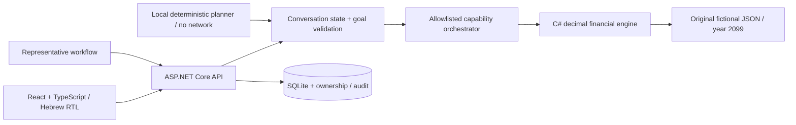
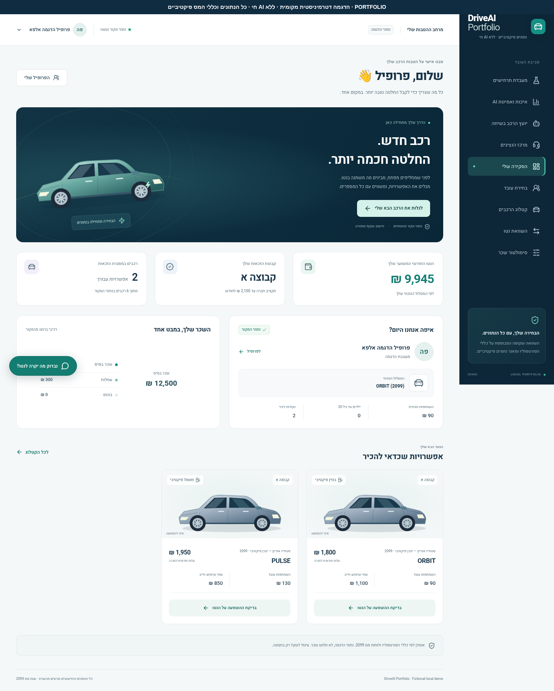
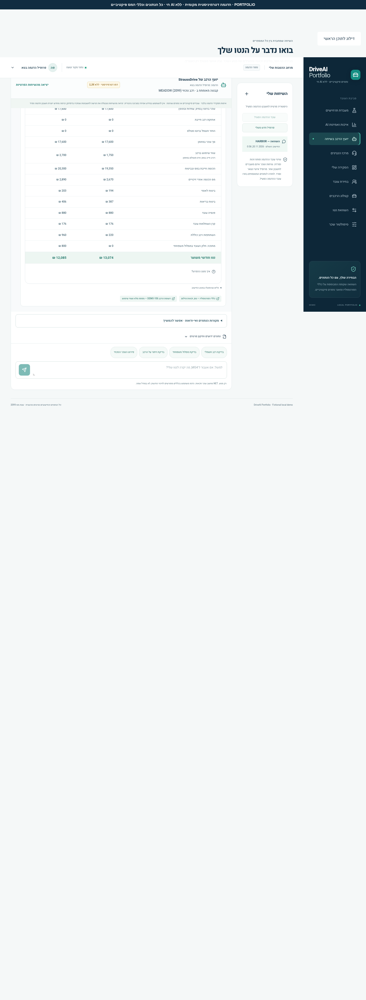
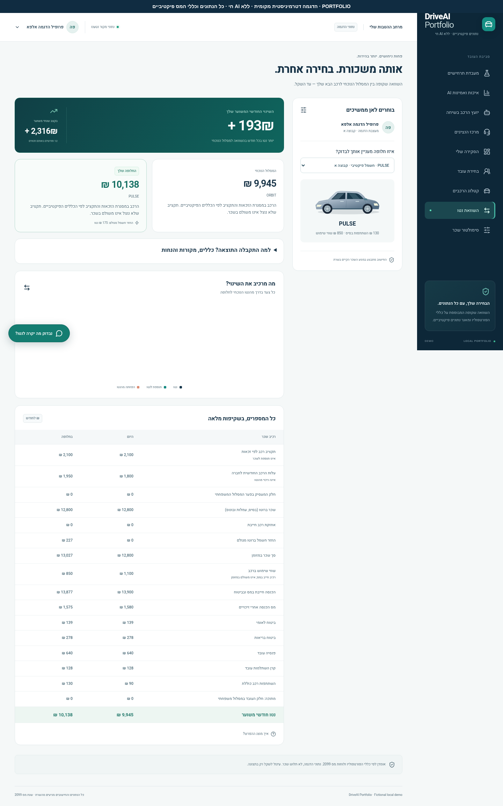
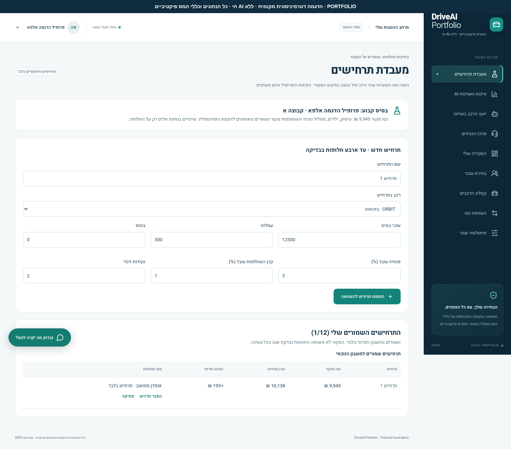

# StraussDriveAI-Portfolio

**עברית:** מהדורת פורטפוליו עצמאית להדגמה מקומית של ייעוץ הטבות רכב ושינוי בנטו. כל האנשים, הרכבים, המדיניות וטבלאות המס במהדורה זו הם יצירה פיקטיבית חדשה. אין צורך בחשבון OpenAI, Railway או שירות בתשלום.

**English:** A self-contained, local portfolio demonstrating vehicle-benefit decisions through deterministic calculations, a conversational workflow and bounded tool planning. Every profile, vehicle, policy and financial reference is newly authored fiction. No OpenAI key, Railway access or paid account is required.

> **Deterministic demo — no live AI. / הדגמה דטרמיניסטית — ללא מודל חי.**
> This is an independent portfolio, not an official Strauss product or a payroll service. No challenge documents, government datasets, production links or original Git history are included. Public-release and project-code licensing approval remain pending; see [licensing review](docs/LICENSING.md).

[עברית](#עברית--סקירת-הפרויקט) · [English](#english--project-overview) · [Run locally / הפעלה](#local-installation--התקנה-מקומית) · [Tests / בדיקות](#testing--בדיקות) · [Release review](docs/RELEASE_REVIEW.md)

## עברית — סקירת הפרויקט

המערכת עונה על שאלה עסקית פשוטה עם חישוב מורכב מאחוריה: ״מה יקרה לנטו שלי אם אחליף רכב או אוותר עליו?״ היא מציגה בסיס נוכחי מול חלופות, בודקת זכאות ומסבירה השתתפות, מסים והטבות. השרת הוא הסמכות הכספית; הממשק והשיחה אינם ממציאים סכומים.

### יכולות

- ממשק עברי RTL למחשב ולנייד: סקירה, קטלוג, השוואה, סימולטור, שיחה, מעבדת תרחישים ומסך נציג.
- מנוע `decimal` דטרמיניסטי, חישוב גילום, הסברים ומקור נתונים עם חתימת SHA-256.
- השוואת כמה חלופות מול בסיס יחיד, מסלול משפחתי, חשמלי וויתור לפי עיסוק.
- שמירת שיחות ותרחישים פרטיים ב-SQLite; שאלות המשך, אישור שינוי עובדות והעברה מפורשת לנציג.
- מתכנן דטרמיניסטי עם ממשק ספק ניתן להחלפה. סכימות כלים, אימות מטרות וצעדים, הגבלת פעולות ומניעת ביצוע כפול נשמרו. תוכניות native מתוסרטות נבדקות ללא רשת.
- עוגיות חתומות נפרדות לעובד ולנציג, בדיקות בעלות, CSRF, הגבלת קצב וביטול מפגש. שער Basic אופציונלי נבדק עם אישורי בדיקה בלבד.

### תסריט קצר למגייסים

1. בחרו **פרופיל הדגמה בטא** ובשיחה כתבו: `השוואה משפחתית מול HARBOR`.
2. צפו לנטו פיקטיבי **13,074 מול 12,085**, הפרש **−989** וחלק עובד בפער **800**. שאלו: `מה חלקי בפער התקציב?` ורעננו.
3. אצל אותו פרופיל בקשו `אני רוצה לוותר על רכב` — התפקיד הפיקטיבי מחייב רכב ולכן הבקשה נחסמת.
4. עברו ל**פרופיל הדגמה גמא** ולשיחה חדשה, ובקשו ויתור: **16,778 מול 18,470**, שינוי **+1,692**.
5. במעבדת התרחישים בחרו חלופה, חשבו ושמרו. הנתונים המקוריים אינם משתנים.
6. לפנייה אנושית: אחרי בחירת חלופה שלחו `נציג לאישור השתתפות`, אשרו את ההעברה, עברו למרכז הנציגים ולחצו על כניסת הדגמה ללא קוד בהפעלה המקומית. ענו וחזרו לשיחת העובד. אין זו הזדהות ארגונית.

### מגבלות

טבלאות המס הן המצאה לימודית לשנת 2099; אינן חוקי מס של מדינה כלשהי ואינן כללי שטראוס. הסכומים מוצגים ביחידות הדגמה בסימון ₪, ללא תוקף שכר אמיתי. אין שירות AI חי, OCR, חיבור HR/שכר, SSO או מוכנות לייצור. השיחה מבינה אוצר ביטויים מוגבל — השתמשו בדוגמאות המתועדות. הפרדה בחשבון הדגמה אינה זיהוי עובד אמיתי; אין להזין מידע אישי. מפתחות ועוגיות מקומיים נשמרים ללא הצפנה ארגונית. הבדיקות בדפדפן הן Chromium במחשב ובאמולציית נייד, לא בדיקה בכל מכשיר.

## Architecture / ארכיטקטורה



**Technologies:** .NET 10, ASP.NET Core, C#, React 19, TypeScript, Vite, SQLite, xUnit, Vitest, Playwright, axe-core, Tailwind CSS, Recharts, Lucide and locally bundled Heebo fonts. Third-party licenses remain separate; [notices](THIRD_PARTY_NOTICES.md) include their terms.

## Screenshots / צילומי מסך

All screenshots were captured locally from this edition using fictional profiles. They do not link to a hosted service or consume an account.






## Local installation / התקנה מקומית

Prerequisites / דרישות: **.NET 10 SDK** (see `global.json`), **Node.js 22+**, npm, and **Python 3.10+** for the launcher/reference authoring tool. Installation restores public packages and therefore requires network access; the running demo needs no external account or provider. Commands work from the repository root; `python3` may be `python` on your system.

```sh
dotnet restore StraussDriveAI-Portfolio.sln
dotnet build StraussDriveAI-Portfolio.sln --no-restore
npm --prefix frontend ci
python3 tools/run_demo.py
```

Open **http://127.0.0.1:5173**. Both servers bind to loopback; API port **5080**, frontend **5173**. If frontend port 5173 is occupied, use `python3 tools/run_demo.py --frontend-port 5174 --api-port 5081`. Ctrl+C stops both. The launcher uses Development demo enrollment and a local `.local/portfolio.db`. Leave the representative code empty for the local role demonstration. All local profiles are fictional. No `.env` file or credential is needed. The runtime contains no external AI networking adapter, so supplying an API key cannot enable paid calls.

For a production-style frontend build / לבניית הממשק:

```sh
npm --prefix frontend run build
```

`frontend/dist` includes third-party notices. Build outputs, local databases and keys are ignored and are **not** part of the source release. Do not upload local state or deploy this demo as an organizational service.

## Testing / בדיקות

```sh
dotnet test StraussDriveAI-Portfolio.sln
npm --prefix frontend test
npm --prefix frontend run build
dotnet run --project tools/StraussDrive.Data
```

Browser tests / בדיקות דפדפן:

```sh
cd frontend
npx playwright install chromium
npm run test:e2e
```

If Chromium is already installed, set `PLAYWRIGHT_CHROMIUM_EXECUTABLE` to its path; `/usr/bin/chromium` is detected automatically on Linux. Browser-test traffic is restricted to localhost. Keep ports 5080/5173 free; stop the demo before testing. For occupied ports, set `PORTFOLIO_API_PORT` and `PORTFOLIO_UI_PORT` to distinct unprivileged ports for Playwright. Test servers use temporary synthetic databases, never a production service.

`data/portfolio-demo.json` contains five independently authored financial cases (50 field checks). [The Python reference oracle](tools/author_fictional_references.py) uses an independent Decimal implementation and imports no application code. It is an explicit authoring tool, not run by tests to rewrite expected results. [Validation evidence](docs/VALIDATION.md) records actual results for this edition; previous private-project test counts are not reused.

## English — project overview

This portfolio shows how a conversational product can support financial decisions without giving a language model authority over money or eligibility. The retained C# engine handles decimal arithmetic and gross-up; server-owned profiles, bounded capabilities and explicit confirmations protect the workflow. The React interface presents comparisons, evidence, explanations and human follow-up.

The original challenge import layer, source artifacts, benchmark answers and screenshots have been removed. The replacement has six invented vehicles, five unmistakably fictional profiles, three occupations and newly authored policy/tax tables. These are original examples, not renamed challenge rows. The family policy requires three eligible children up to age 20 and splits the positive gap 40% employee / 60% employer. The electric net benefit is 175 demonstration units. None of these are real payroll guidance.

The local planner is deterministic and recognizes a limited documented vocabulary. It is not an LLM and no live-AI quality is claimed. The provider interface, structured goal/tool contracts, orchestrator and native-plan regression tests remain available for architectural review; the external HTTP AI adapter is deliberately absent. This is not an official Strauss/Microsoft service and has no connection to the author's paid deployment.

Security includes separate signed demo-role cookies, ownership checks, CSRF defenses and rate limits. Demo role enrollment is a teaching facility, not enterprise authentication. SQLite/key storage is local; no real personal data should be entered. Browser coverage is desktop/mobile Chromium, not a universal accessibility or security certification.

## Source, licensing and publication / מקור, רישוי ופרסום

- [Provenance and exclusions](docs/PROVENANCE.md): retained project implementation versus excluded supplied materials.
- [Licensing review and MIT proposal](docs/LICENSING.md): project ownership confirmation is still required; **no project-code license has been applied**.
- [Third-party notices](THIRD_PARTY_NOTICES.md): upstream terms are preserved, not relicensed.
- [Release review and publication checklist](docs/RELEASE_REVIEW.md): review the fresh history and wait for explicit owner approval before creating or publishing a repository.

No public repository, remote, hosted demo, account integration or deployment is created by preparing this edition.
