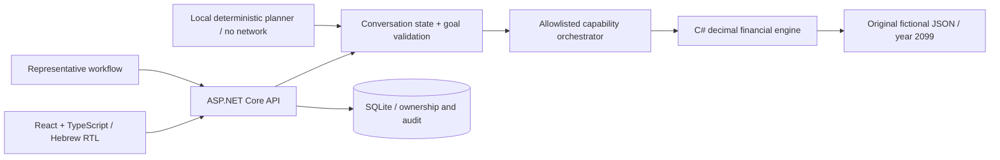

# StraussDriveAI-Portfolio

**English:** A vehicle-benefit decision application that turns “What happens to my take-home pay?” into a server-validated comparison. It combines a C# deterministic financial engine, a React/TypeScript interface, a bounded conversational workflow and a representative handoff process.

**עברית:** אפליקציה לבחינת הטבות רכב, שהופכת את השאלה ״מה יקרה לנטו שלי?״ להשוואה שהשרת מחשב ומאמת. המימוש משלב מנוע כספי דטרמיניסטי ב-C#, ממשק React/TypeScript, תהליך שיחה מוגבל בכלים והעברת בקשות לנציג.

> **Independent fictional demo · Deterministic advisor · No live LLM**<br>
> **הדגמה עצמאית עם נתונים פיקטיביים · יועץ דטרמיניסטי · ללא מודל שפה חי**
>
> This public portfolio is not an official Strauss or Microsoft product. Local execution needs no OpenAI key, paid hosting or external account. Installing public dependencies requires network access; download or connectivity costs depend on your environment.

I developed the project code with assistance from AI tools, including Codex; no other human developers contributed code. Third-party libraries, icons and fonts retain their own licenses.

פיתחתי את קוד הפרויקט בסיוע כלי AI, ובהם Codex, ללא תרומת קוד של מפתחים אנושיים נוספים. ספריות, סמלים וגופנים של צד שלישי כפופים לרישיונות שלהם.

**Documented portfolio verification:** 57 backend tests · 11 frontend tests · 50 financial field checks · 10 desktop/mobile browser tests. These are the recorded 21 November 2026 results, not new test runs for this README update. [Evidence and scope](docs/VALIDATION.md).

**English navigation:** [Screenshots](#screenshots) · [Engineering](#engineering) · [Architecture](#architecture) · [Walkthrough](#walkthrough) · [Setup](#setup) · [Tests](#tests) · [Limitations and rights](#boundaries)

**ניווט בעברית:** [צילומי מסך](#screenshots) · [יכולות והחלטות הנדסיות](#engineering) · [ארכיטקטורה](#architecture) · [הדגמה קצרה](#walkthrough) · [התקנה והפעלה](#setup) · [בדיקות](#tests) · [מגבלות וזכויות](#boundaries)

<a id="screenshots"></a>

## Screenshots / צילומי מסך

All four captures come from this clean fictional edition. They show invented profiles and financial examples, not real payroll, official challenge assets or a hosted production service. Expand each view and click the image to inspect it at full size.

כל ארבעת הצילומים נלקחו ממהדורת הפורטפוליו הפיקטיבית בלבד. פתחו כל תצוגה ולחצו על התמונה לצפייה בגודל מלא.

<details open>
<summary><strong>1. Dashboard / סקירה אישית</strong></summary>

A fictional employee baseline, eligibility budget and available vehicles in a Hebrew RTL interface. / מצב נוכחי של פרופיל פיקטיבי, תקציב זכאות ורכבים לבחירה בממשק עברי.

[](docs/screenshots/dashboard.png)

</details>

<details>
<summary><strong>2. Deterministic advisor / יועץ דטרמיניסטי</strong></summary>

A local multi-vehicle conversation compares HARBOR and LANTERN with the current arrangement, with explicit no-AI labeling and expandable evidence. / השוואה בשיחה מול המצב הנוכחי, סימון מפורש שאין קריאת AI ופירוט הניתן לפתיחה.

[](docs/screenshots/advisor.png)

</details>

<details>
<summary><strong>3. Comparison and explanation / השוואה והסבר</strong></summary>

ORBIT → PULSE: displayed net changes from 9,945 to 10,138 demonstration units, with a waterfall chart and salary breakdown. / שינוי פיקטיבי של 193 יחידות נטו, לצד תרשים ופירוט רכיבי השכר.

[](docs/screenshots/comparison.png)

</details>

<details>
<summary><strong>4. Scenario Lab / מעבדת תרחישים</strong></summary>

A hypothetical salary/vehicle scenario saved to the local demo account, without changing its imported baseline. / תרחיש היפותטי השמור בחשבון ההדגמה המקומי, בלי לשנות את פרופיל המקור.

[](docs/screenshots/scenarios.png)

</details>

<a id="engineering"></a>

## Capabilities and engineering decisions / יכולות והחלטות הנדסיות

| Capability / יכולת                            | Implementation and boundary / מימוש וגבול אחריות                                                                                                                                                                                                                                           |
| --------------------------------------------- | ------------------------------------------------------------------------------------------------------------------------------------------------------------------------------------------------------------------------------------------------------------------------------------------ |
| Deterministic finance / חישוב כספי            | Server-side C# `decimal` arithmetic, progressive fictional tax tables, electric gross-up and separate display rounding. React displays results; it does not calculate payroll. / החישוב בשרת; עיגול לתצוגה אינו משנה את החישוב הפנימי.                                                     |
| Authoritative eligibility / זכאות בשרת        | Occupation, group, budget, family policy and waiver rules are checked by the backend. A conversational claim cannot grant entitlement. / טענה בשיחה אינה משנה זכאות מאומתת.                                                                                                                |
| Bounded conversation / שיחה עם כלים מוגבלים   | The local deterministic planner recognizes limited vocabulary. Allowlisted tools, structured goals, validated steps and duplicate-execution protections constrain the workflow. The provider interface is architectural; no external LLM adapter is distributed. / ממשק הספק אינו מודל חי. |
| Comparisons and scenarios / השוואות ותרחישים  | Compare alternatives against one current baseline; explore hypothetical salary inputs in the simulator and Scenario Lab. Saved Lab inputs are recalculated and bound to their source fingerprint. / נתוני תרחיש אינם משנים את המקור.                                                       |
| Representative process / תהליך נציג           | Separate confirmation before creating a handoff; a role-separated representative can respond, record participation and resume the employee workflow. / אישור פנייה מפורש ותשובת נציג מתועדת.                                                                                               |
| Persistence and explanations / התמדה והסברים  | SQLite stores conversations, facts, tickets, audit events and owned scenarios. Decision evidence exposes the applicable rules, assumptions and SHA-256 source fingerprint. / שמירת הקשר והצגת מקור והנחות.                                                                                 |
| Tested access boundaries / גבולות גישה נבדקים | Separate signed role cookies, ownership checks, CSRF header checks, rate limits and session revocation. These protect a fictional demo, not an enterprise identity system. / הרשאות הדגמה אינן הזדהות ארגונית.                                                                             |

The [fictional fixture](data/portfolio-demo.json) contains six invented vehicles, five profiles and three occupations. Its year-2099 policy requires three eligible children up to age 20 for the family route, splits its positive budget gap **40% employee / 60% employer**, and provides a **175-unit net electric benefit**. These are newly authored examples, not renamed challenge rows or real tax rules. [Provenance](docs/PROVENANCE.md).

נתוני ההדגמה מקוריים ופיקטיביים. שנת 2099, הסכומים והמדיניות נועדו להמחשת המנגנון בלבד; הם אינם כללי שטראוס או בסיס לתלוש שכר אמיתי.

<a id="architecture"></a>

## Architecture and technologies / ארכיטקטורה וטכנולוגיות



| Layer / שכבה                   | Technologies / טכנולוגיות                                                        |
| ------------------------------ | -------------------------------------------------------------------------------- |
| Backend and data / שרת ונתונים | .NET 10, ASP.NET Core, C#, SQLite, original JSON loader                          |
| Frontend / ממשק                | React 19, TypeScript, Vite, Tailwind CSS, Recharts                               |
| Verification / בדיקות          | xUnit, Vitest, Playwright, axe-core; independent Python Decimal reference oracle |
| UI assets / נכסי ממשק          | Lucide icons, locally bundled Heebo fonts, generic project SVG car artwork       |

The JSON loader supplies validated data to the existing domain services. The conversational layer chooses bounded actions; the engine and backend enforce money and eligibility. Persistence is local. Structured/native-shaped plans are exercised with scripted providers, not a live API. No OpenAI request or cloud deployment is part of this edition.

שכבת הנתונים מספקת קלט למנוע; שכבת השיחה בוחרת פעולות מוגבלות; השרת קובע זכאות וסכומים. האחסון מקומי, ואין רכיב שמפעיל ספק AI חיצוני.

<a id="walkthrough"></a>

## Short recruiter walkthrough / הדגמה קצרה למגייסים

The interface and supported prompts are Hebrew. Use the exact examples below to explore the deterministic vocabulary. / הממשק בעברית; הדוגמאות הבאות מדגימות את אוצר הביטויים הנתמך.

| Step / שלב                          | Action and expected behavior / פעולה ותוצאה צפויה                                                                                                                                                                                                         |
| ----------------------------------- | --------------------------------------------------------------------------------------------------------------------------------------------------------------------------------------------------------------------------------------------------------- |
| 1. Family comparison / מסלול משפחתי | Select **פרופיל הדגמה בטא** and send `השוואה משפחתית מול HARBOR`. Expect **13,074 → 12,085**, monthly difference **−989**, employee gap share **800**. / בחרו בטא ובקשו השוואה משפחתית.                                                                   |
| 2. Follow-up / המשכיות              | Ask `מה חלקי בפער התקציב?`, then refresh. The known profile and conversation persist. / בדקו שאלת המשך ושמירה אחרי רענון.                                                                                                                                 |
| 3. Policy rejection / חסימת זכאות   | For Beta, send `אני רוצה לוותר על רכב`. The fictional occupation requires a car; no approved waiver net should be invented. / הוויתור נחסם לפי העיסוק.                                                                                                    |
| 4. Eligible waiver / ויתור מותר     | Select **פרופיל הדגמה גמא**, start a new conversation and request waiver. Expect **16,778 → 18,470**, difference **+1,692**. / עברו לגמא ולשיחה חדשה.                                                                                                     |
| 5. Hypothesis / תרחיש היפותטי       | Open Scenario Lab, choose a vehicle, calculate, save and reload. The imported profile remains unchanged. / חשבו ושמרו בלי לשנות את נתוני המקור.                                                                                                           |
| 6. Human handoff / פנייה לנציג      | After selecting an alternative, send `נציג לאישור השתתפות` and confirm the handoff. Open the representative screen, enter the local demo role with an empty code, answer the ticket and return to the employee chat. / אשרו פנייה, ענו כנציג וחזרו לשיחה. |

All figures are demonstration units displayed with a ₪ symbol. The annual view assumes 12 unchanged months; it is not an annual payroll forecast.

<a id="setup"></a>

## Local setup and run / התקנה והפעלה מקומית

**Prerequisites / דרישות:** the .NET SDK pinned by [`global.json`](global.json): **10.0.404**, with compatible patch roll-forward; **Node.js 22+**, npm and **Python 3.10+**. Restore/install downloads public packages and browser binaries. The running advisor needs no API key, paid service, hosting subscription or external account.

**Linux/macOS shell — from the repository root / מתיקיית השורש:**

```sh
dotnet restore StraussDriveAI-Portfolio.sln
dotnet build StraussDriveAI-Portfolio.sln --no-restore
npm --prefix frontend ci
python3 tools/run_demo.py
```

**Windows PowerShell command equivalents / פקודות מקבילות ב-PowerShell:**

```powershell
dotnet restore StraussDriveAI-Portfolio.sln
dotnet build StraussDriveAI-Portfolio.sln --no-restore
npm --prefix frontend ci
py -3 tools/run_demo.py
```

Use `python` instead of `py -3` if that is how Python is installed. **Execution was validated on Linux; Windows and macOS have not been manually verified.** The PowerShell block documents command syntax, not an additional platform-support claim.

Open **http://127.0.0.1:5173**. The frontend and API bind to loopback on ports **5173** and **5080**. Ctrl+C stops the launcher’s servers. Its Development-mode enrollment uses a fictional local account and `.local/portfolio.db`; no `.env` or credentials are needed. The external AI adapter is absent, so adding an API key does not enable live calls.

If ports are occupied / אם הפורטים תפוסים:

```sh
python3 tools/run_demo.py --frontend-port 5174 --api-port 5081
```

In PowerShell, substitute `py -3` for `python3`. Open port 5174 for that invocation. The launcher expects the default **Debug** backend build above.

Build the frontend / בניית הממשק:

```sh
npm --prefix frontend run build
```

`frontend/dist` includes third-party notices. Dependencies, build outputs, local databases and signing keys are ignored by Git and are not part of the source release. Do not upload local application state.

<a id="tests"></a>

## Testing and verified results / בדיקות ותוצאות מאומתות

The following results are recorded for portfolio commit [`b045bfe`](https://github.com/hadas1906-commits/StraussDriveAI-Portfolio/commit/b045bfec93c97c33044a3d845fc9294d188843fd), on **21 November 2026**. They come from this fictional edition, not the private project. This documentation-only revision does not claim a new application test run. [Commands, cases and limits](docs/VALIDATION.md).

| Automated verification / בדיקה אוטומטית       | Recorded result / תוצאה מתועדת                                           |
| --------------------------------------------- | ------------------------------------------------------------------------ |
| Backend / שרת                                 | **57 tests passed**, zero failed/skipped                                 |
| Frontend / ממשק                               | **11 tests passed**                                                      |
| Independent financial references / ערכי ייחוס | **50 field checks matched**, zero mismatches, across five original cases |
| Browser workflows / תהליכים בדפדפן            | **10 passed**: five desktop and five mobile-emulated Chromium cases      |
| .NET and frontend builds / בנייה              | Passed; .NET build had zero warnings/errors                              |

**Automated coverage** includes financial outcomes, eligibility, electric gross-up, tool authority/deduplication, CSRF/ownership/roles, persistence, handoff, scenario save/reload and targeted axe accessibility checks. **Manual inspection** covers screenshot content and presentation; it is not a separate financial or accessibility certification. Mobile coverage is browser emulation, not physical-device testing.

הבדיקות האוטומטיות נפרדות מהסקירה החזותית של הצילומים. אין כאן מדד להבנת שפה של מודל חי או טענה לבדיקה בכל מכשיר ודפדפן.

From the repository root / מתיקיית השורש:

```sh
dotnet test StraussDriveAI-Portfolio.sln
npm --prefix frontend test
npm --prefix frontend run build
dotnet run --project tools/StraussDrive.Data
```

Browser tests — stop the local demo first / בדיקות דפדפן — עצרו קודם את ההדגמה:

```sh
cd frontend
npx playwright install chromium
npm run test:e2e
```

`cd frontend` changes the working directory; return to the repository root before running root-level commands again. On Linux, `/usr/bin/chromium` is detected automatically. Alternatively set `PLAYWRIGHT_CHROMIUM_EXECUTABLE` to an installed Chromium executable. Test traffic is restricted to localhost, using temporary fictional databases.

For alternate test ports, from the repository root / פורטים חלופיים לבדיקות:

```sh
# Linux/macOS
PORTFOLIO_API_PORT=5081 PORTFOLIO_UI_PORT=5174 npm --prefix frontend run test:e2e
```

```powershell
# PowerShell — current session only; remove the overrides when finished
$env:PORTFOLIO_API_PORT = "5081"
$env:PORTFOLIO_UI_PORT = "5174"
npm --prefix frontend run test:e2e
Remove-Item Env:PORTFOLIO_API_PORT, Env:PORTFOLIO_UI_PORT
```

The browser fixture also uses Linux-style temporary paths, so Windows browser execution is not established. The [Python Decimal oracle](tools/author_fictional_references.py) independently authored the committed financial expectations without importing application code. It is an explicit fixture-authoring tool; tests do not run it to overwrite expected results.

<a id="boundaries"></a>

## Limitations, security and rights / מגבלות, אבטחה וזכויות

- **Fiction, not payroll advice / נתונים פיקטיביים:** year 2099, invented vehicles and policies; no real tax/legal accuracy. No official Strauss PDF, workbook, JSON, government dataset or private-project history is distributed.
- **Deterministic, not an LLM / דטרמיניסטי:** limited Hebrew vocabulary and documented prompts. No live-model quality claim, OCR, HR/payroll integration or autonomous external actions. The quality screen’s local counters are not proof of language understanding.
- **Demo identity / זהות הדגמה:** signed employee/representative cookies, ownership checks, CSRF defenses and rate limits are implemented. They are not SSO or enterprise authentication. Secure-cookie behavior depends on environment/HTTPS; the local Development demo runs over loopback HTTP. The optional Basic gate uses synthetic credentials in tests, not shared access details for a live service.
- **Local state / מצב מקומי:** SQLite and signing keys are local; there is no application-level database encryption. Use fictional inputs only. Organizational retention, recovery, load and security review remain outside this portfolio’s readiness claims.
- **Verification limits / גבולות הבדיקה:** Chromium desktop/mobile emulation and targeted automated accessibility checks; no universal browser/device coverage, full accessibility certification or production-readiness claim.

### Credits and source-visible policy / קרדיטים ומדיניות צפייה בקוד

Heebo fonts use **OFL-1.1** and Lucide icons **ISC**. Other packages retain their upstream terms; see [THIRD_PARTY_NOTICES.md](THIRD_PARTY_NOTICES.md). Generic inline car artwork is project implementation. [Provenance and excluded materials](docs/PROVENANCE.md) distinguish it from third-party and supplied challenge materials.

**No MIT or other project-code license is granted** for owner-controlled code, documentation, artwork or fictional examples. Public visibility does not itself grant broad reuse, modification or redistribution rights. GitHub platform terms and legal exceptions still apply; public repositories can be viewed/forked and are technically downloadable. Third-party rights are not overridden. Installation instructions describe technical capability, not a general reuse license. [Rights and authorship review](docs/LICENSING.md).

**לא ניתן רישיון MIT או רישיון כללי אחר לפרויקט.** פרסום לצפייה אינו מעניק כשלעצמו זכויות שימוש חוזר, שינוי או הפצה רחבות. תנאי GitHub והחריגים שבדין ממשיכים לחול, ורישיונות צד שלישי נשמרים. הוראות ההפעלה אינן רישיון שימוש כללי.

This repository is already public. [Release history](docs/RELEASE_REVIEW.md) separates the owner-authorized publication from historical pre-release checks and their original limitations. Publication is not a legal certification of ownership or of agreements that were not available for review. No paid production demo is linked, and no hosted service is required to inspect or run this portfolio locally.
